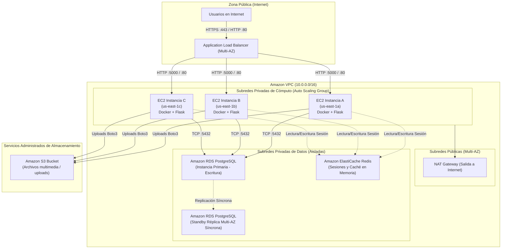

# Workshop 6 — EC2 en una arquitectura escalable

**Curso:** Computación en la Nube e Internet de las Cosas

**Temas:**

- EC2
- Load Balancer
- Auto Scaling
- Availability Zones
- Stateless applications
- Escalabilidad horizontal
- Alta disponibilidad
- Arquitectura cloud

---

# Objetivos

Al finalizar este workshop el estudiante será capaz de:

- Identificar las limitaciones de una única EC2.
- Diseñar una arquitectura con múltiples instancias.
- Comprender el propósito de un Load Balancer.
- Relacionar EC2 con Auto Scaling.
- Analizar alta disponibilidad y escalabilidad.
- Identificar problemas de estado en aplicaciones distribuidas.

---

# Parte 1. Arquitectura inicial

```text
Internet
   |
   v
EC2
 |
 +-- Nginx
 |
 +-- Flask
```

Analice:

### 1. ¿Qué sucede si la instancia EC2 falla?
Si la máquina virtual sufre una avería a nivel de hardware físico en el hipervisor de AWS, si el kernel entra en *kernel panic*, o si el proceso Docker colapsa:
* **Indisponibilidad total (100% Downtime):** Ningún usuario puede acceder al servicio.
* **Pérdida de peticiones en tránsito:** Cualquier transacción en vuelo se interrumpe sin posibilidad de reintento automático.
* **Recuperación lenta y manual:** Requiere que un administrador humano detecte la caída, entre a la consola de AWS y reinicie o recree la instancia desde cero.

### 2. ¿Qué sucede si aumenta el tráfico masivamente?
Al recibir una avalancha repentina de peticiones concurrentes:
* **Agotamiento de CPU y RAM:** El uso del procesador llega al 100% y la memoria se satura, provocando que el kernel invoque al proceso `OOM Killer` (Out Of Memory) que terminará matando a Docker o a Python.
* **Agotamiento de descriptores de sockets:** Se llena la cola de conexiones TCP (`SYN backlog`), haciendo que Nginx empiece a devolver errores `502 Bad Gateway` o `504 Gateway Timeout`.
* **Degradación de la experiencia:** La latencia se dispara hasta que la aplicación deja de responder.

### 3. ¿Dónde existe un Single Point of Failure (SPoF)?
El **Single Point of Failure (Punto Único de Fallo)** es la **instancia EC2 misma**:
* Depende de una única máquina virtual, un único volumen EBS, y reside en una única Zona de Disponibilidad (`us-east-1d`). Si el rack, el switch de red o el centro de datos que aloja esa AZ se corta, todo el sistema deja de existir.

---

# Parte 2. Evolución

Diseñe:

```text
                 Load Balancer
                /      |      \
               /       |       \
             EC2      EC2      EC2
              |        |        |
            Flask    Flask    Flask
```

Identifique:

### 1. ¿Qué componente distribuye el tráfico?
El **Application Load Balancer (ALB)** de AWS. Opera en la **Capa 7 (Aplicación)** del modelo OSI:
* Recibe el tráfico HTTP/HTTPS en un único punto DNS público.
* Evalúa reglas de enrutamiento y aplica algoritmos de balanceo (como *Round Robin* ponderado o *Least Outstanding Requests*).
* Realiza **Health Checks** periódicos a una ruta de salud (ej. `GET /health`); si una instancia deja de responder, el ALB deja de enviarle tráfico automáticamente y lo redirige a las instancias sanas.

### 2. ¿Dónde se ejecuta cada instancia?
Cada instancia se ejecuta en una **Subred Privada** independiente, distribuida en distintas **Zonas de Disponibilidad (Availability Zones - AZs)** de la región de AWS (ejemplo: Subred A en `us-east-1a`, Subred B en `us-east-1b`, Subred C en `us-east-1c`).

### 3. ¿Por qué conviene distribuir instancias entre Availability Zones?
* **Aislamiento de fallos catastróficos:** Cada AZ está compuesta por uno o varios centros de datos separados físicamente por kilómetros, con suministro eléctrico independiente, generadores de respaldo y conexiones de fibra óptica redundantes.
* Si una AZ sufre una inundación, incendio o corte masivo de energía, las instancias alojadas en las otras AZs siguen operando con normalidad, garantizando una **disponibilidad del 99.99% (Alta Disponibilidad / HA)**.

---

# Parte 3. Stateless

Explique qué ocurre si una petición llega a EC2-1 y la siguiente llega a EC2-2:

```text
Request 1 -> EC2-1
Request 2 -> EC2-2
```

### ¿Qué pasa si la sesión está guardada únicamente en memoria de EC2-1?
* Cuando la petición 2 sea dirigida por el Load Balancer hacia `EC2-2`, esta instancia **no tiene conocimiento del inicio de sesión**, porque la memoria RAM de `EC2-1` está aislada de la de `EC2-2`.
* El usuario experimentará cierres de sesión aleatorios y errores de autenticación continuos a medida que el balanceador alterna las solicitudes entre instancias.

---

# Parte 4. Persistencia

Analice una arquitectura donde cada instancia mantiene archivos locales:

```text
EC2-1 -> archivo.txt
EC2-2 -> archivo.txt
```

¿Son necesariamente el mismo archivo?

### ¿Son necesariamente el mismo archivo?
**NO.** Cada instancia EC2 cuenta con su propio volumen EBS (`/dev/root`) exclusivo. Un archivo escrito localmente en el disco de `EC2-1` no existe en `EC2-2`. Si el usuario sube un avatar a `EC2-1` y luego recarga la página cayendo en `EC2-2`, el avatar se romperá (Error 404).

Proponga una estrategia de almacenamiento compartido o administrado.

### Estrategia de almacenamiento compartido o administrado:

```text
              +-------------+-------------+
              |                           |
              v                           v
     [ Amazon S3 ]               [ Amazon EFS ]
(Almacenamiento de Objetos)     (NFS Compartido Multi-AZ)
- Imágenes, PDFs, videos        - Código fuente compartido
- Backups y logs                - Archivos compartidos POSIX
- Durabilidad 99.999999999%     - Montaje simultáneo en 100+ EC2s
```

1. **Amazon S3 (Simple Storage Service):** Es la mejor práctica para archivos estáticos, uploads de clientes y multimedia. Las instancias EC2 no guardan archivos en disco; usan el SDK de AWS (`boto3`) para subir y servir los archivos directamente desde S3.
2. **Amazon EFS (Elastic File System):** Sistema de archivos de red basado en NFSv4 que puede ser montado simultáneamente por cientos de instancias EC2 en distintas AZs como un directorio local (ej. `/mnt/shared-data`).

---

# Parte 5. Auto Scaling

Investigue y documente:

### 1. ¿Qué problema resuelve Auto Scaling?
Auto Scaling resuelve el dilema clásico de la infraestructura de TI:
* **Evita la indisponibilidad:** Agrega automáticamente nuevas instancias cuando hay picos de tráfico para mantener el rendimiento y la disponibilidad.
* **Optimiza costos (Frugalidad Cloud):** Destruye automáticamente las instancias ociosas cuando el tráfico baja en la noche o fines de semana, pagando solo por lo que realmente se consume segundo a segundo.
* **Auto-reparación (Self-Healing):** Si una instancia sufre un fallo de hardware, Auto Scaling la termina y lanza una nueva idéntica en su reemplazo automáticamente usando el User Data.

### 2. Diferencia entre Escalamiento Vertical y Horizontal

| Criterio | Escalamiento Vertical (Scale-Up / Down) | Escalamiento Horizontal (Scale-Out / In) |
| :--- | :--- | :--- |
| **Definición** | Modificar el tamaño de la máquina existente (ej. de `t3.micro` a `t3.2xlarge`). | Sumar o restar instancias del mismo tipo en paralelo detrás de un balanceador. |
| **Límite físico** | **Existe un tope.** Está limitado a la máquina más potente que ofrezca AWS. | **Prácticamente ilimitado.** Se pueden lanzar decenas o cientos de instancias. |
| **Disponibilidad** | **Requiere Downtime.** Cambiar el tipo de instancia exige apagar la máquina unos minutos. | **Zero Downtime.** Las instancias entran y salen en caliente sin detener el servicio. |
| **Resiliencia** | **Mantiene el SPoF.** Si esa única máquina grande falla, se cae todo. | **Alta Resiliencia.** Si una máquina falla, las demás absorben la carga. |
| **Costo** | Las máquinas de gama alta crecen en costo de forma exponencial. | Lineal y granular; se pagan incrementos pequeños de cómputo. |

### 3. Métricas de señal de escalamiento (CloudWatch)
* **Uso promedio de CPU (`CPUUtilization`):** Escalar agregando una instancia si el promedio del grupo supera el 70% durante 3 minutos consecutivos.
* **Número de solicitudes por objetivo (`RequestCountPerTarget`):** Escalar si cada contenedor/instancia recibe más de 800 peticiones por minuto.
* **Tiempo de respuesta del backend (`TargetResponseTime`):** Escalar si la latencia promedio supera los 400 ms.


Ejemplos:

```text
CPU > umbral
```

o:

```text
Número de solicitudes > umbral
```

---

# Parte 6. Diseño

Construya una propuesta:

```text
                 Internet
                    |
                    v
              Load Balancer
                    |
          +---------+---------+
          |         |         |
         EC2       EC2       EC2
          |         |         |
       Flask     Flask     Flask
          \         |         /
           \        |        /
             Base de datos
```

Indique qué elementos deberían ser:

- Públicos.
- Privados.
- Escalables.
- Persistentes.
- Monitoreados.


### Diagrama de la Arquitectura Propuesta:



### Clasificación técnica de los componentes:

| Componente | Tipo de Recurso | Clasificación de Seguridad | Propiedad Arquitectónica |
| :--- | :--- | :---: | :--- |
| **Application Load Balancer (ALB)** | Balanceador Capa 7 | **Público** | **Escalable** (AWS ajusta su capacidad automáticamente) |
| **Instancias EC2 (Flask + Nginx)** | Cómputo (Auto Scaling) | **Privado** | **Escalable** (mediante métricas de CPU en CloudWatch) |
| **Amazon RDS (PostgreSQL Multi-AZ)** | Base de Datos Relacional | **Privado** | **Persistente** (Failover automático en otra AZ) |
| **Amazon ElastiCache (Redis)** | Caché en Memoria / Sesiones | **Privado** | **Persistente volátil / Ultra-baja latencia** |
| **Amazon S3** | Almacenamiento de Objetos | **Público/Privado vía IAM** | **Persistente** (11 nueves de durabilidad) |
| **AWS CloudWatch & Alarmas** | Observabilidad y Telemetría | **Interno AWS** | **Monitoreado** (Métricas de CPU, memoria, logs y alarmas) |

---

# Reto final

Explique cómo evolucionaría el laboratorio:

```text
Docker local
    |
    v
Docker en EC2
    |
    v
Múltiples EC2
    |
    v
Load Balancer
    |
    v
Auto Scaling
```

Relacione esta evolución con **Journey to Cloud (J2C)**.

# Reto Final — Evolución y Journey to Cloud (J2C)

### 1. El camino de la evolución en la nube:

```text
[ Nivel 1: Docker local ]
  - Desarrollo en localhost
  - No apto para producción
  - Dependiente de la máquina del desarrollador
           |
           v
[ Nivel 2: Docker en EC2 ] (Workshops 1, 2, 3)
  - IaaS / Lift & Shift
  - La aplicación vive en la nube
  - Persiste el Single Point of Failure (1 máquina)
           |
           v
[ Nivel 3: Múltiples EC2 + User Data ] (Workshops 4, 5)
  - Infraestructura como Código básica (IaC)
  - Redundancia entre zonas de disponibilidad
  - Servidores desechables y reproducibles
           |
           v
[ Nivel 4: Load Balancer + Stateless ] (Workshop 6)
  - Desacoplamiento de clientes y servidores
  - Chequeos de salud continuos (Self-Healing)
  - Sesiones y almacenamiento centralizados
           |
           v
[ Nivel 5: Auto Scaling + Servicios Cloud-Native Administrados ]
  - Elasticidad completa bajo demanda
  - Adopción de RDS, ElastiCache y S3
  - Enfoque "Cattle, not Pets" (Ganado, no Mascotas)
```

### 2. Relación con Journey to Cloud (J2C) y las 6 R's de Migración:
* **De Rehost (Lift & Shift) a Replatform / Refactor:** Inicialmente, mover una aplicación a EC2 es simplemente alquilar un servidor en la nube (*Rehost*). La verdadera transformación cloud (*Journey to Cloud*) ocurre cuando desacoplamos la aplicación y reemplazamos servidores administrados manualmente por **servicios gestionados (PaaS / Serverless)**:
  * Sustituir la base de datos en EC2 por **Amazon RDS**.
  * Sustituir discos locales por **Amazon S3**.
  * Sustituir instancias EC2 manuales por **contenedores serverless con AWS Fargate / ECS**.
* **Filosofía "Pets vs. Cattle":** En arquitecturas tradicionales, las máquinas son "mascotas" con nombre propio que se cuidan y reparan manualmente por SSH. En una arquitectura cloud escalable moderna, las instancias son "ganado": son idénticas, se crean automáticamente con User Data cuando sube la demanda, y si una falla, se destruye y se reemplaza sin impacto para los usuarios.

---

# Entregable

- Diagrama de arquitectura.
- Respuestas de análisis.
- Comparación entre arquitectura de una instancia y múltiples instancias.
- Explicación de escalabilidad horizontal.
- Propuesta de evolución hacia una arquitectura más administrada.

### Comparación: Arquitectura de 1 Instancia vs. Múltiples Instancias

| Dimensión | 1 Instancia EC2 (Monolito) | Múltiples EC2 con ALB y Auto Scaling |
| :--- | :--- | :--- |
| **Disponibilidad** | Baja (Cualquier fallo tira el servicio). | **Alta Disponibilidad (99.99%)** tolerante a caídas de AZ. |
| **Tolerancia a Fallos** | Nula (Existe un SPoF crítico). | **Total:** Las instancias fallidas se reemplazan solas. |
| **Elasticidad** | Nula; capacidad fija que no responde a picos. | **Dinámica:** Crece y decrece según demanda real. |
| **Mantenimiento** | Requiere ventanas de mantenimiento con corte. | **Zero-Downtime:** Despliegues continuos tipo Rolling Update. |

### Propuesta de evolución hacia una arquitectura más administrada (Cloud-Native):
Para el siguiente ciclo evolutivo de este proyecto se recomienda:
1. **Migrar de EC2 a AWS Fargate / Amazon ECS:** Eliminar por completo la necesidad de administrar parches del sistema operativo y kernels en EC2; los contenedores de Docker corren directamente como tareas *serverless*.
2. **Implementar CloudFront (CDN):** Servir contenido estático y caché de borde a nivel global con protección perimetral DDoS (AWS Shield).
3. **Migrar secretos a AWS Secrets Manager:** Rotación automática de credenciales de bases de datos sin quemar contraseñas en variables de entorno.