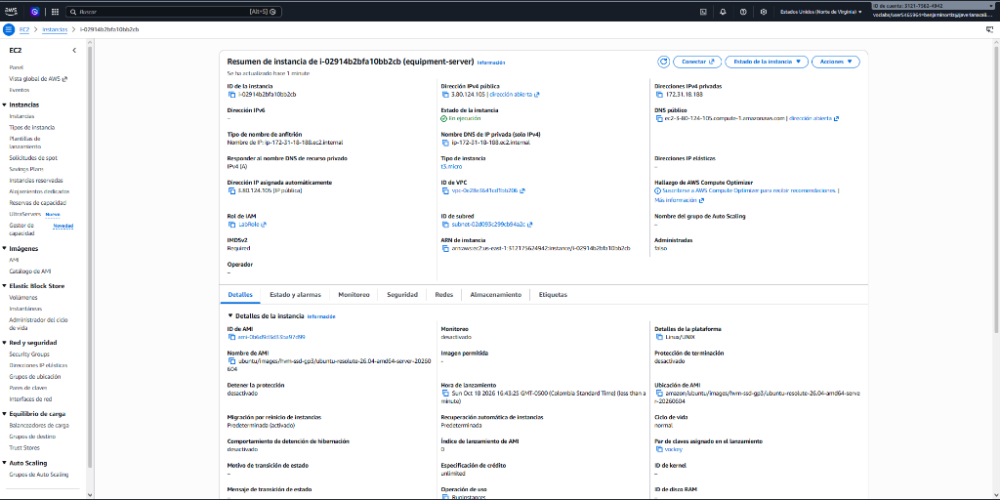
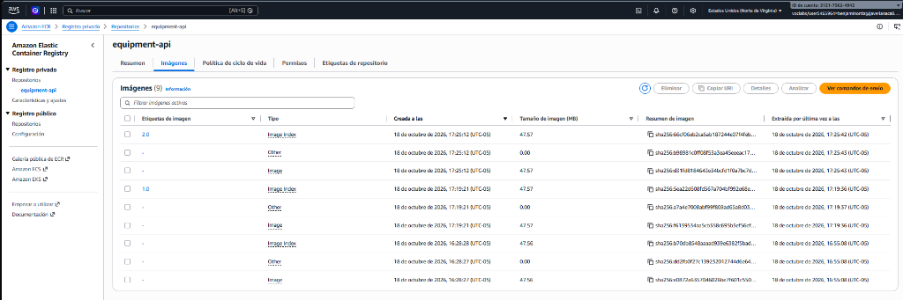
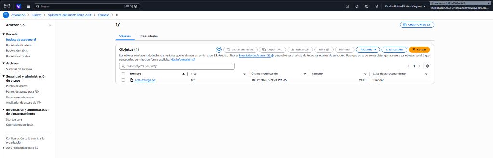
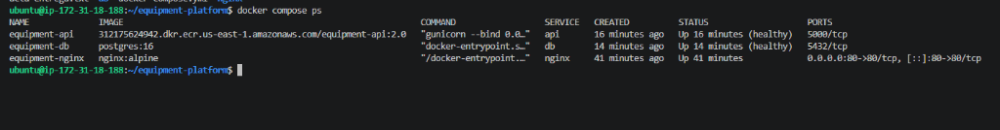
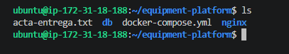
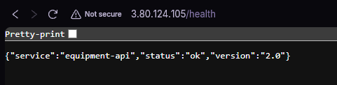
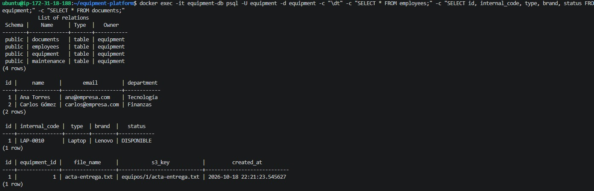

# Entregable — Sistema de seguimiento de equipos en AWS

**Curso:** Computación en la Nube e Internet de las Cosas  
**Estudiante:** Benjamín Ortiz (`benjaminortiz@javerianacali.edu.co`)  
**Account ID:** `312175624942` | **Región:** `us-east-1`

---

## 1. Diagrama de Arquitectura
### Diagrama

```text
                         +----------------+
                         |     Usuario    |
                         +-------+--------+
                                 |
                                 v
                              Internet
                                 | (TCP 80)
                                 v
                    +------------------------+
                    |       Amazon EC2       |
                    |   (IAM Role: LabRole)  |
                    |    Docker Compose      |
                    |                        |
                    |  +----------------+    |
                    |  |     Nginx      |    |
                    |  +-------+--------+    |
                    |          | :5000       |
                    |          v             |
                    |  +----------------+    |
                    |  |   Flask API    |    |
                    |  +-------+--------+    |
                    +----------|-------------+
                               |
                     +---------+---------+
                     |                   |
                     v                   v
               PostgreSQL              S3
               relacional          documentos
            (Vol: postgres_data) (Bucket privado)

                       ^
                       | docker pull
                 +-----+-----+
                 |    ECR    |
                 | Flask img |
                 +-----------+
```

---

## 2. Código Fuente y Configuración

Toda la estructura solicitada en la guía se encuentra organizada en esta carpeta:

```text
entregable/
├── api/
│   ├── app.py              # API Flask conectada a PostgreSQL (psycopg2) y S3 (boto3)
│   ├── requirements.txt    # Flask, psycopg2-binary, boto3, gunicorn
│   └── Dockerfile          # Imagen Python + Gunicorn en puerto 5000
├── nginx/
│   └── nginx.conf          # Reverse Proxy escuchando en puerto 80 hacia http://api:5000
├── db/
│   └── init.sql            # Esquema relacional (employees, equipment, maintenance, documents)
├── docker-compose.yml      # Orquestación con imagen desde ECR, healthchecks y volumen persistente
└── .env.example            # Variables de entorno de ejemplo
```

---

## 3. Repositorio en Amazon ECR

* **Nombre del repositorio:** `equipment-api`
* **URI del repositorio:** `312175624942.dkr.ecr.us-east-1.amazonaws.com/equipment-api`
* **Versiones publicadas:** `1.0` y `2.0`

---

## 4. Evidencias de Despliegue

### 4.1 Instancia EC2 en ejecución (con `LabRole` asociado)


### 4.2 Repositorio Amazon ECR con versiones `1.0` y `2.0`


### 4.3 Bucket Amazon S3 con documento cargado a través de la API


### 4.4 Estado de los contenedores en Docker Compose (`Up` y `healthy`)


### 4.5 Verificación de no reconstrucción en EC2 (sin código fuente de la API en EC2)


### 4.6 Respuesta de la API en navegador (`/health` versión `2.0`)


### 4.7 Verificación de tablas y registros en PostgreSQL (`psql`)


---

## 5. Explicación Arquitectónica

> **¿Qué ocurre desde que hago `docker push` hasta que el usuario obtiene una respuesta de Flask?**

1. **Publicación en el Registro (`docker push` $\rightarrow$ Amazon ECR):**
   * En la máquina de desarrollo local se construye la imagen Docker (`equipment-api`) que empaqueta el código Python, las dependencias (`Flask`, `psycopg2-binary`, `boto3`, `gunicorn`) y el servidor WSGI Gunicorn configurado en el puerto `5000`.
   * Previa autenticación mediante `aws ecr get-login-password`, el cliente Docker local envía las capas inmutables de la imagen hacia el repositorio privado `312175624942.dkr.ecr.us-east-1.amazonaws.com/equipment-api` en **Amazon ECR**.

2. **Descarga y Orquestación en el Servidor (`docker pull` $\rightarrow$ Amazon EC2 + Docker Compose):**
   * La instancia **Amazon EC2** cuenta con un **IAM Role (`LabRole`)** adjunto a nivel de infraestructura, lo que le permite autenticarse contra ECR sin almacenar credenciales estáticas en disco.
   * Al ejecutar `docker compose up -d` en la EC2, Docker descarga (`pull`) la imagen de la API directamente desde ECR utilizando la directiva `image:` (cumpliendo el principio *build once, deploy anywhere*, sin tener el código fuente ni compilar dentro de EC2).
   * Docker Compose crea una red privada virtual (`bridge`) y levanta tres servicios en orden controlado:
     1. **`db` (`postgres:16`):** Monta el volumen persistente `postgres_data` y ejecuta `init.sql` para inicializar las tablas (`employees`, `equipment`, `maintenance`, `documents`). Expone su puerto `5432` únicamente dentro de la red interna de Docker.
     2. **`api` (`equipment-api`):** Espera a que el `healthcheck` de `db` (`pg_isready`) reporte estado `healthy` antes de iniciar Gunicorn en el puerto interno `5000`.
     3. **`nginx` (`nginx:alpine`):** Publica el puerto `80` de la EC2 hacia el exterior (`0.0.0.0:80->80/tcp`).

3. **Flujo de la Petición del Usuario (Usuario $\rightarrow$ Nginx $\rightarrow$ Flask $\rightarrow$ PostgreSQL / S3):**
   * Cuando el usuario realiza una petición HTTP desde su navegador a `http://3.80.124.105/...`, el paquete atraviesa Internet y llega al firewall perimetral de AWS (**Security Group**), el cual permite únicamente el tráfico entrante por el puerto `80` (bloqueando accesos directos al puerto `5000` de Flask o `5432` de PostgreSQL).
   * El contenedor **`equipment-nginx`** recibe la solicitud en el puerto `80` y, siguiendo la directiva `proxy_pass http://api:5000;` de `nginx.conf`, resuelve mediante el DNS interno de Docker Compose el nombre `api` hacia la IP privada del contenedor de Flask, reenviándole la petición HTTP.
   * **Gunicorn / Flask** recibe la petición en el puerto `5000` y ejecuta la lógica del endpoint solicitado:
     * Si requiere datos estructurados (ej. `/empleados`, `/equipos`), abre una conexión TCP hacia el hostname interno **`db`** en el puerto `5432`, ejecuta la consulta SQL en **PostgreSQL** y obtiene las filas.
     * Si requiere almacenar un archivo (ej. `POST /equipos/1/documentos`), utiliza el SDK **`boto3`** (autenticado automáticamente mediante el IAM Role `LabRole` de la EC2) para subir el objeto binario al bucket privado **`equipment-documents-benja-2026`** en **Amazon S3**, y registra el metadato (`s3_key`) en PostgreSQL.
   * Finalmente, **Flask** serializa la respuesta en formato **JSON** y la devuelve a **Nginx**, el cual la retransmite como respuesta HTTP al navegador del usuario.

---

## 6. Respuestas a las Preguntas de Defensa (Sección 44)

1. **¿Por qué utilizar ECR?**  
   Porque es un registro de contenedores privado, seguro e integrado nativamente con AWS IAM, lo que permite almacenar versiones inmutables de nuestras imágenes (`1.0`, `2.0`) y descargarlas desde EC2 sin exponerlas al público ni depender de límites de descarga externos.

2. **¿Por qué no construir la imagen directamente en EC2?**  
   Porque compilar imágenes (`docker build`) consume CPU, RAM y disco del servidor de producción, obliga a llevar el código fuente al servidor y rompe el principio *Build once, deploy the same image* (si tuviéramos 10 instancias EC2, compilar 10 veces por separado es lento y propenso a diferencias entre servidores).

3. **¿Qué diferencia existe entre ECR y S3?**  
   **Amazon ECR** es un registro especializado exclusivamente en almacenar, versionar y distribuir **imágenes de contenedores Docker/OCI** por capas mediante comandos `docker push`/`pull`. **Amazon S3** es un almacenamiento de **objetos de propósito general** para guardar archivos de la aplicación (PDFs, fotografías, backups) consumido vía HTTP/SDK (`boto3`).

4. **¿Por qué PostgreSQL y S3 tienen responsabilidades diferentes?**  
   Porque **PostgreSQL** es un motor relacional transaccional (ACID) diseñado para consultar, filtrar y relacionar datos estructurados en tablas con baja latencia, mientras que **S3** está diseñado para almacenar archivos binarios pesados (no estructurados) con alta durabilidad y bajo costo sin inflar ni degradar el rendimiento de la base de datos.

5. **¿Qué información debería estar en PostgreSQL?**  
   Los datos estructurados del negocio: empleados, equipos, estados, asignaciones, historial de mantenimientos y únicamente los **metadatos** de los documentos (ID del documento, `equipment_id`, nombre del archivo, fecha de creación y la ruta `s3_key`).

6. **¿Qué información debería estar en S3?**  
   Los archivos binarios reales: fotografías de los equipos, PDFs de actas de entrega, facturas y evidencias de mantenimiento.

7. **¿Por qué Flask utiliza `db` como hostname?**  
   Porque dentro de un contenedor Docker, `localhost` (`127.0.0.1`) apunta al propio contenedor de Flask (donde no corre PostgreSQL). Como ambos contenedores están en la misma red de Docker Compose, el DNS interno de Docker resuelve automáticamente el nombre del servicio (`db`) hacia la IP privada del contenedor de PostgreSQL.

8. **¿Qué pasaría si eliminamos la EC2?**  
   Se eliminarían los contenedores en ejecución y el volumen local `postgres_data` almacenado en el disco EBS de esa instancia EC2 (salvo que tuviéramos un snapshot o usáramos RDS). Sin embargo, **NO se perderían** ni las imágenes de nuestra API (porque viven en **Amazon ECR**) ni los documentos o fotografías subidos por los usuarios (porque viven en **Amazon S3**).

9. **¿Qué componente deberíamos cambiar para soportar varias instancias de Flask?**  
   Deberíamos extraer **PostgreSQL** fuera de una única instancia EC2 hacia una base de datos externa compartida (como **Amazon RDS**) para que todas las instancias de Flask consulten los mismos datos, y colocar un **Balanceador de Carga (ALB o Nginx)** al frente para repartir las peticiones entre las instancias de Flask.

10. **¿Cómo evolucionaría esta arquitectura hacia alta disponibilidad?**  
    Colocando un **Application Load Balancer (ALB)** público que distribuya el tráfico hacia múltiples instancias **EC2** repartidas en distintas **Zonas de Disponibilidad (Multi-AZ)** bajo un **Auto Scaling Group**, migrando PostgreSQL a **Amazon RDS en modo Multi-AZ** (con failover automático) y manteniendo **Amazon S3** y **Amazon ECR** que ya son altamente disponibles a nivel regional.
