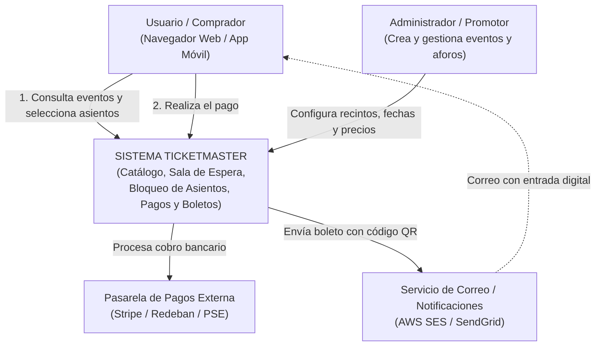
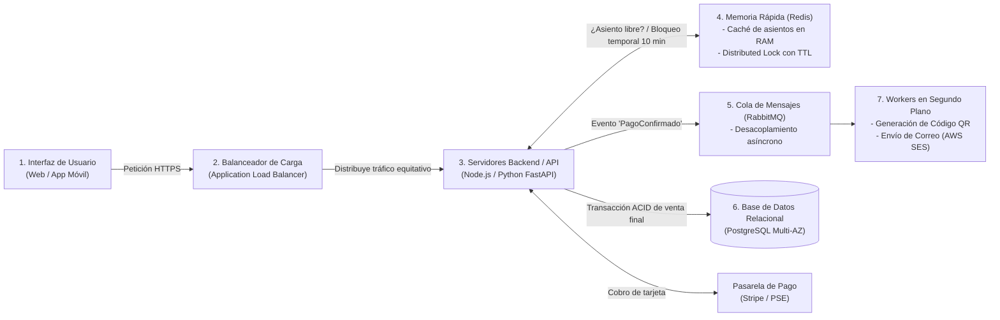

# Actividad 1 — Diseño de Sistema Escalable: Ticketmaster

**Curso:** Computación en la Nube e Internet de las Cosas  
**Tema:** Modelo Cliente-Servidor, Desacoplamiento, Alta Concurrencia, Manejo de Concurrencia y Escalabilidad en la Nube.

---

## 1. Contexto y Planteamiento del Problema

**Ticketmaster** es una plataforma de venta masiva de boletos para eventos en vivo (conciertos en estadios, eventos deportivos y teatros). 

A diferencia del comercio electrónico convencional, la venta de entradas para eventos de alta demanda presenta desafíos de ingeniería únicos:
1. **Picos extremos de concurrencia:** Al abrirse la venta general de una gira mundial, ingresan cientos de miles de usuarios al mismo segundo intentando acceder a un inventario finito (ej. un estadio de 40.000 asientos).
2. **Problema de Sobreventa (*Double Booking*):** Dos o más usuarios intentan seleccionar y pagar la misma silla exacta (ej. *Sección Occidental, Fila C, Asiento 12*) en el mismo milisegundo.
3. **Bloqueo temporal con expiración (*Hold Lock / TTL*):** Al seleccionar asientos, el sistema debe apartarlos temporalmente por **8 a 10 minutos** mientras el usuario introduce su información bancaria. Si el pago no se completa en ese lapso, los asientos deben liberarse de forma atómica y automática para otros compradores.
4. **Resiliencia de la Base de Datos:** Si 200.000 usuarios consultan simultáneamente el estado de los asientos directo a una base de datos en disco, el servidor colapsará por agotamiento de conexiones I/O.

---

## 2. Requerimientos del Sistema

### Requerimientos Funcionales (RF)
* **RF-01 Consulta de Eventos:** Los usuarios pueden buscar eventos por artista, recinto, fecha y categoría.
* **RF-02 Mapa de Asientos en Tiempo Real:** Visualizar interactivamente el mapa del recinto y el estado de cada silla (*Disponible*, *En proceso de reserva*, *Vendida*).
* **RF-03 Reserva Temporal de Asientos:** Bloqueo atómico de hasta 4 asientos por usuario durante un máximo de **10 minutos**.
* **RF-04 Procesamiento de Pagos:** Integración segura con pasarelas de pago externas (tarjetas de crédito, débito, PSE).
* **RF-05 Emisión de Boleto Digital:** Generación de boleto digital único con código QR dinámico antifraude y envío por correo electrónico.
* **RF-06 Liberación Automática:** Expiración de reservas incompletas tras 10 minutos para reintegrar los asientos al inventario disponible.

### Requerimientos No Funcionales (RNF)
* **RNF-01 Consistencia Estricta (Cero Sobreventa - ACID):** Garantía matemática de que ningún asiento físico se venderá más de una vez.
* **RNF-02 Baja Latencia en Lectura (< 100 ms):** Visualización ultrarrápida del catálogo de eventos y mapas de asientos mediante capas de caché en memoria y CDN.
* **RNF-03 Alta Disponibilidad (99.99%):** Arquitectura desacoplada donde la lentitud en la pasarela de pagos no bloquee la navegación de otros usuarios.
* **RNF-04 Desacoplamiento Asíncrono:** Emisión de entradas, generación de PDFs y envío de correos ejecutados mediante colas y *workers* en segundo plano.
* **RNF-05 Control de Carga:** Protección perimetral para admitir tráfico en lotes controlados evitando caídas por denegación de servicio.

---

## 3. Diagrama de Contexto

Muestra la interacción de los usuarios externos y servicios terceros con la plataforma de Ticketmaster:



---

## 4. Diagrama de Arquitectura de Alto Nivel

Representación de la infraestructura distribuida requerida para soportar alta concurrencia:



---

## 5. Explicación Técnica de los Componentes

### 1. Interfaz de Usuario (Frontend)
Aplicación web (Single Page Application en React/Vue) y móvil. Renderiza de forma reactiva el mapa vectorial del recinto (SVG o Canvas) mostrando colores según la disponibilidad de cada silla en tiempo real.

### 2. Balanceador de Carga (Load Balancer - ALB)
Punto único de entrada público en la nube. Recibe el tráfico masivo y lo distribuye entre múltiples réplicas del Backend usando algoritmos como *Round Robin* o *Least Outstanding Requests*. Monitorea la salud de los servidores con *Health Checks* activos.

### 3. Servidores Backend / API (Capa de Cómputo)
Servicios desacoplados y sin estado (*stateless*). No almacenan sesiones de usuario en memoria local para permitir escalabilidad horizontal (sumar o restar servidores automáticamente según la demanda).

### 4. Caché en Memoria y Bloqueo Distribuido (Redis)
* **¿Por qué es indispensable?** Si 100.000 personas consultan el estado de las sillas al mismo tiempo, consultar el disco duro de PostgreSQL saturaría el pool de conexiones en segundos. Redis responde en submilisegundos desde la memoria RAM.
* **Distributed Lock con TTL:** Cuando un usuario hace clic en un asiento, se ejecuta un comando atómico `SET asiento_101 user_456 NX EX 600`.
  * `NX`: Asigna la reserva únicamente si el asiento **no está reservado**. Si dos usuarios hacen clic a la vez, solo uno gana el lock; al otro se le informa de inmediato que el asiento ya fue tomado.
  * `EX 600`: Define un tiempo de vida (*Time-To-Live*) de **600 segundos (10 minutos)**. Si el usuario cierra el navegador o no paga, la clave se borra sola en Redis y el asiento vuelve a estar libre sin intervención humana.

### 5. Cola de Mensajes (RabbitMQ / SQS)
* **¿Por qué desacoplar?** La generación criptográfica de códigos QR y el envío de correos electrónicos mediante SMTP toman entre 2 y 4 segundos por usuario.
* Si el backend hiciera esto de forma sincrónica, la experiencia del usuario sería lenta y los hilos del servidor se agotarían. Con la cola, el backend confirma la compra en milisegundos y le delega el trabajo pesado a los *workers*.

### 6. Base de Datos Principal (PostgreSQL)
Base de datos relacional con soporte transaccional **ACID (Atomicidad, Consistencia, Aislamiento y Durabilidad)**. Cuando la pasarela aprueba el pago, se ejecuta una transacción que actualiza el estado del asiento a `VENDIDO` de forma definitiva e irreversible.

---

## 6. Flujo de Estados de un Asiento

```text
       [ DISPONIBLE ]
             |
             |  (Usuario selecciona asiento -> Lock en Redis con TTL 10 min)
             v
       [ EN RESERVA / BLOQUEADO ]
             |
             +-----------------------------------------+
             |                                         |
             | (Pago aprobado en < 10 min)             | (Expira tiempo / Cancelado)
             v                                         v
        [ VENDIDO ]                              [ DISPONIBLE ]
  (Registrado en PostgreSQL)               (Liberado en Redis automáticamente)
```
