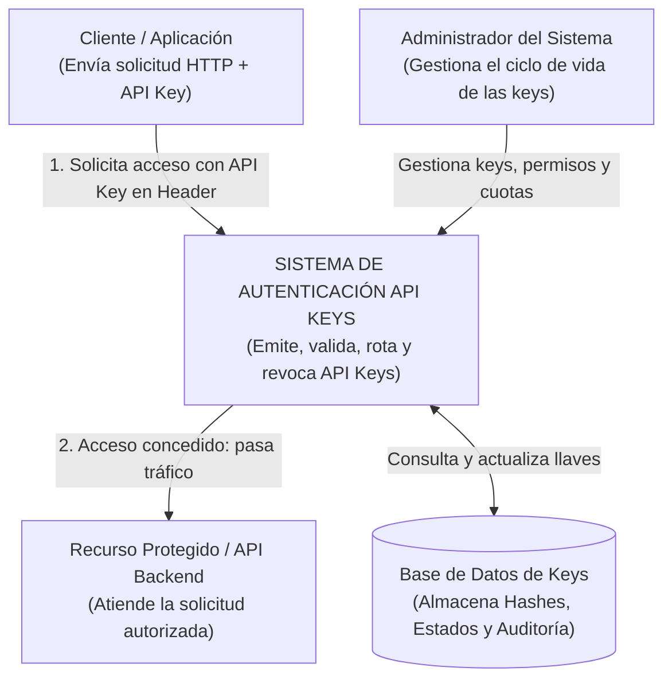
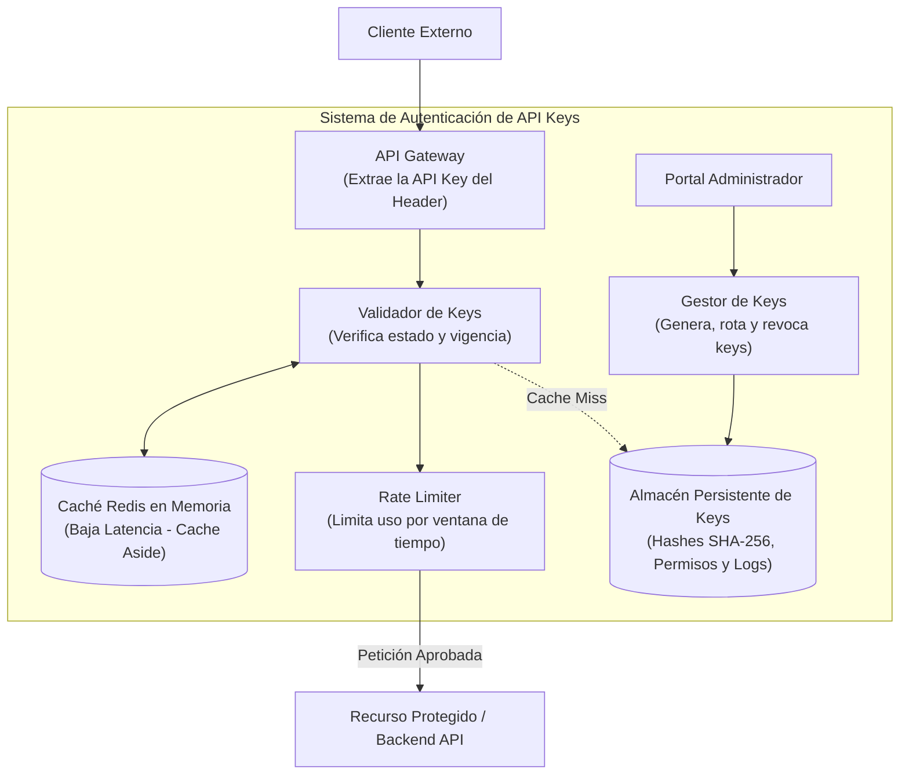

# Actividad 2 — Sistema de Autenticación mediante API Keys

**Curso:** Computación en la Nube e Internet de las Cosas  
**Tema:** Seguridad Perimetral, Autenticación, Rate Limiting, Hashing Criptográfico y Escalabilidad en APIs.

---

## 1. Descripción del Sistema

El sistema implementa una capa perimetral de seguridad para proteger APIs y recursos empresariales mediante el uso de **API Keys**. 

Permite controlar de manera estricta qué clientes, aplicaciones o servicios tienen autorización para consumir los endpoints protegidos, administrando el ciclo de vida completo de las llaves (creación, asignación de permisos, rotación y revocación) y evitando accesos indebidos o abusos de tráfico mediante limitadores de tasa (*Rate Limiting*).

---

## 2. Requerimientos del Sistema

### Requerimientos Funcionales (RF)
* **RF-01 Generación de API Keys:** Generar API Keys únicas, criptográficamente seguras y asociadas a un cliente, aplicación o servicio específico.
* **RF-02 Permisos y Cuotas de Uso:** Asignar roles, permisos (lectura/escritura) y límites de uso (ej. cuota mensual o tasa de peticiones por minuto) a cada key.
* **RF-03 Validación en Tiempo Real:** Validar la existencia, vigencia y permisos de la key en cada solicitud HTTP entrante.
* **RF-04 Gestión del Ciclo de Vida:** Permitir la revocación inmediata, rotación gradual y expiración temporal de keys sin afectar el funcionamiento de otras keys activas del mismo cliente.
* **RF-05 Soporte Multi-Key:** Permitir que un mismo cliente o empresa posea múltiples keys activas simultáneamente (ej. ambiente de desarrollo, pruebas y producción).
* **RF-06 Portal de Administración:** Exponer una API y panel administrativo seguro para que los administradores gestionen el ciclo de vida de las llaves.

### Requerimientos No Funcionales (RNF)
* **RNF-01 Seguridad en el Almacenamiento (No Texto Plano):** La API Key nunca debe guardarse en texto plano en la base de datos; solo se almacena su *hash* criptográfico unidireccional (SHA-256 o Argon2) y un prefijo público para identificación.
* **RNF-02 Validación de Baja Latencia (< 5 ms):** La comprobación de la key debe ser ultrarrápida utilizando una capa de caché en memoria (Redis) para evitar que cada petición golpee la base de datos persistente.
* **RNF-03 Escalabilidad Horizontal Sin Estado (*Stateless*):** El servicio de validación de llaves no debe compartir estado en memoria local, permitiendo desplegar múltiples réplicas detrás de un balanceador de carga.
* **RNF-04 Alta Disponibilidad:** El subsistema de autenticación debe estar altamente disponible para evitar convertirse en un cuello de botella o punto único de fallo para los recursos protegidos.
* **RNF-05 Trazabilidad y Auditoría Completa:** Registro estructurado de eventos críticos: creación, último uso, rotación, intentos de acceso denegados y revocaciones.

---

## 3. Diagrama de Contexto

El diagrama de contexto ilustra la interacción entre los clientes que consumen los recursos protegidos, los administradores que gestionan las credenciales, y los componentes de datos:

> **Descripción del flujo de contexto:**  
> El cliente o aplicación externa envía una solicitud incluyendo su API Key en las cabeceras HTTP. El sistema de autenticación la intercepta, valida su autenticidad y estado; si es válida y cumple con los límites de uso, permite el paso hacia la API protegida. Si la clave es inválida, expirada o supera la cuota, rechaza la petición con un código HTTP `401 Unauthorized` o `429 Too Many Requests`.

---

## 4. Diagrama de Alto Nivel

Arquitectura interna desacoplada del sistema de autenticación:

---

## 5. Explicación Detallada de los Componentes

1. **API Gateway:**
   Punto de entrada perimetral. Intercepta toda petición HTTP entrante, extrae el token del encabezado (ej. `X-API-Key: app_live_abc123...`) y lo transmite al servicio de validación. Si no contiene clave, la rechaza de inmediato en el borde.

2. **Validador de Keys (Caché + Base de Datos):**
   * **Caché First (Redis):** Al recibir la clave, computa su hash y consulta primero en Redis. Si la clave ya está en caché (*Cache Hit*), la validación toma menos de 2 milisegundos.
   * **Base de Datos Persistente (Cache Miss):** Si la clave no está en memoria, consulta el almacén persistente (PostgreSQL), valida permisos y la almacena en Redis con un tiempo de vida (TTL).
   * **Validación de Estado:** Comprueba que la clave no esté en estado `REVOCADA` o `EXPIRADA`.

3. **Rate Limiter (Limitador de Tasa):**
   Implementa algoritmos como *Token Bucket* o *Sliding Window* en Redis para contar las peticiones por segundo/minuto asociadas a esa API Key. Si el cliente supera su cuota asignada, se le bloquea temporalmente respondiendo con código HTTP `429 Too Many Requests`.

4. **Gestor de Keys (Portal Admin):**
   Módulo administrativo para crear nuevas credenciales, asignarles alcances (*scopes* como `read:products`, `write:orders`), rotar claves antiguas de forma segura y revocarlas instantáneamente si se detecta una filtración.

5. **Almacén de Keys y Auditoría (PostgreSQL):**
   Guarda de forma segura los hashes de las claves, los metadatos de los clientes, las cuotas asignadas y el registro cronológico (*Audit Log*) de cada creación, modificación o bloqueo de credenciales.
